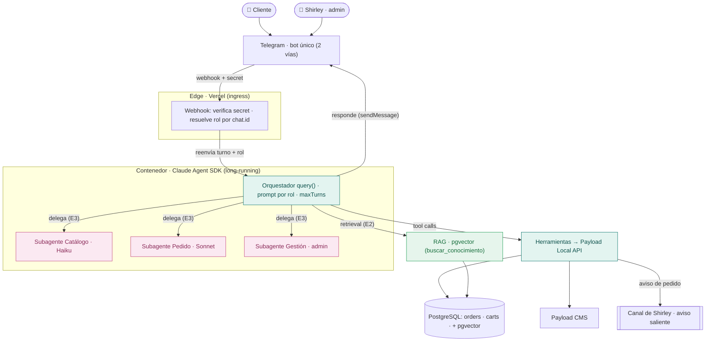

# Especificaciones — Bot Concierge de Nénufar

Blueprint de ingeniería para convertir el notificador de Telegram de Nénufar en un
**bot concierge agéntico** con el **Claude Agent SDK**. Proyecto con doble objetivo:
un producto útil para la tienda **y** un vehículo de aprendizaje (Claude API, RAG, agentes con Node).

## Los documentos y cómo se encadenan

`BRD → PRD → SDD → TSD` — de lo general (por qué) a lo detallado (cómo, exacto).

| # | Documento | Responde | Audiencia |
|---|-----------|----------|-----------|
| [01](./01-BRD.md) | **BRD** — Business Requirements | ¿Por qué lo hacemos? Objetivos, stakeholders, éxito | Negocio / dueña |
| [02](./02-PRD.md) | **PRD** — Product Requirements | ¿Qué construimos? Features, user stories, alcance | Producto |
| [03](./03-SDD.md) | **SDD** — Software Design | ¿Cómo se estructura? Arquitectura, datos, flujos | Diseño / arquitectura |
| [04](./04-TSD.md) | **TSD** — Technical Specification | ¿Cómo se implementa? Contratos, schemas, tools | Implementación |

### Documentos transversales

| # | Documento | Tema |
|---|-----------|------|
| [05](./05-seguridad-guardrails.md) | **Seguridad y Guardrails** | Modelo de amenazas, inyección de prompts, permisos de tools |
| [06](./06-diseno-conversacion.md) | **Diseño de Conversación** | Voz, tono, flujos de diálogo, escalamiento a humano |
| [07](./07-evals.md) | **Evals** | Cómo medimos la calidad del agente (~20 casos, LLM-juez) |
| [08](./08-glosario.md) | **Glosario** | Lenguaje ubicuo (dominio + técnico) |
| [09](./09-estructura-proyecto.md) | **Estructura del Proyecto** | Monorepo, acceso a Payload desde el bot, runtime del edge, migración |
| [10](./10-operacion-y-costos.md) | **Operación, Costos y Release** | Presupuesto de tokens, observabilidad, Definición de Done, rollback |

### Frontend / Storefront (track aparte)

| Documento | Tema |
|-----------|------|
| [frontend/](./frontend/README.md) | Specs del storefront: [PRD](./frontend/01-PRD-storefront.md) + [Diseño](./frontend/02-diseno-storefront.md) (masonry estilo Krafti) |

### Diagrama de arquitectura

Insignias de etapa: 🟩 **E1** agente + tools · 🟢 **E2** RAG · 🩷 **E3** multiagente.

**Versión detallada:** [`diagrama-arquitectura.html`](./diagrama-arquitectura.html) (abrir en navegador) · [artifact en vivo](https://claude.ai/code/artifact/ab3e9525-3e45-4cce-97d2-68a7868d9af5) (privado).

## Alcance del proyecto: 3 etapas

El mismo bot crece de forma incremental. Cada etapa suma un concepto sin rehacer lo anterior.

1. **Etapa 1 — Agente + herramientas** (Agent SDK, tool use)
2. **Etapa 2 — RAG** (pgvector, grounding)
3. **Etapa 3 — Multiagente** (orquestador + subagentes)

El **TSD** detalla la **Etapa 1**; las etapas 2 y 3 quedan esbozadas y se detallarán al llegar a ellas.

## Estado

Borrador `v1` — 2026-08-18. Branch `feature/bot-agentico-specs`.
